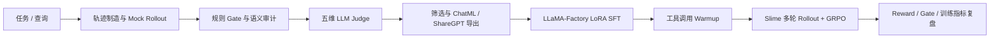

# 购智链｜购物 Agent 全链路后训练

**Shopping Agent Post-Training**

[English](README_EN.md) · [快速开始](#60-秒上手) · [完整数据包](sft_data/ready_to_run/README.md) · [分步文档](docs/00-project-overview.md) · [提交问题](https://github.com/FahaxikiHoney/shopping-agent-post-training/issues)

  

**把购物 Agent 从一条轨迹，带到可评估、可训练、可迭代。**

**购智链**是一套基于大型互联网企业真实购物 Agent 项目实践改造而来的后训练工程。我们将实际项目中的**任务与轨迹数据制造、质量门禁、LLM 评估、LoRA SFT、工具调用 warmup、Slime GRPO 和训练指标复盘**整理为完整流程，并对代码、数据与业务信息做了通用化和脱敏，配套提供可直接使用的数据、配置和逐步文档。

公开版本面向研究与工程实践，使用通用化项目名称及本地 Mock 工具环境，方便从轨迹生成一路复现到 SFT 和 RL。

**克隆后即可从现成数据开始。** 仓库提供清洗后的 ChatML/ReAct 训练集和已转换的 RL tasks；本地 Mock 环境可先跑通数据、工具调用与 Gate。需要模型 API、GPU 或外部训练框架的步骤也明确标出入口和依赖。

## 这套工程能做什么

| 阶段 | 已准备的能力 | 代码入口 |
|---|---|---|
| 任务与轨迹 | 合成请求、Mock 商品/订单工具、多轮 ReAct rollout | `shopping_agent/`、`scripts/run_module.py rollout` |
| 质量控制 | 确定性 Gate、语义审计、轨迹评分与问题定位 | `shopping_agent/react/quality_gate.py`、`trajectory_grader/` |
| LLM 评估 | 五维 Judge、批量评估和结果汇总 | `llm_evaluation/`、`scripts/run_module.py judge` |
| SFT | ChatML/ShareGPT 转换、工具调用 warmup、LLaMA-Factory LoRA 配置 | `training/`、`LLaMA-Factory/` |
| RL | 现成任务转换、Slime rollout adapter、GRPO reward 与指标面板 | `slime_shopping_rl/` |

整体流程：



## 数据已经放好，可以直接开始

| 数据 | 规模 | 用途 |
|---|---:|---|
| ChatML v3 | 1,297 train / 142 validation | `training/lora_sft.yaml` LoRA SFT |
| ReAct ShareGPT | 875 train / 100 eval / 100 test | LLaMA-Factory ReAct LoRA |
| Slime RL tasks | 875 | 直接进入 RL rollout / GRPO 数据流程 |
| 查询与轨迹样例 | 100 条查询及评估示例 | 生成、Gate、Judge 和格式演示 |

集中数据包在 [`sft_data/ready_to_run/`](sft_data/ready_to_run/README.md)，其中说明了每份文件对应的配置、命令和格式。数据集中的无法恢复编码记录已排除，订单/物流标识和平台品牌字段也已泛化。原始线上采集目录不在公开版中。

## 60 秒上手

从仓库根目录运行。无需 GPU 或模型 API，可先生成查询并跑本地质量门禁：

```bash
python scripts/run_module.py --help
python scripts/run_module.py mock-data
python scripts/run_module.py gate
```

想看完整命令和模块映射：打开[代码与现成数据地图](docs/06-code-and-data-map.md)。想从头学习流程：按[项目总览](docs/00-project-overview.md)进入数据制造、评估、SFT 和 RL 分步指南。

## 一键启动各阶段

统一入口 `scripts/run_module.py` 把模块命令整理在一起：

```bash
# 生成本地合成请求并跑 Gate
python scripts/run_module.py mock-data
python scripts/run_module.py gate

# 模型生成轨迹与 LLM Judge（需配置 LLM_API_URL / LLM_API_KEY）
python scripts/run_module.py rollout --sample-size 10 --model YOUR_AGENT_MODEL --overwrite
python scripts/run_module.py judge --count 10 --model YOUR_JUDGE_MODEL

# rollout 后导出 SFT；训练需准备基座模型和 CUDA 环境
python scripts/run_module.py export-sft
python scripts/run_module.py sft --model-path /path/to/Qwen3-0.6B

# RL 需 SFT checkpoint、Megatron checkpoint、Slime/SGLang/CUDA 环境
python scripts/run_module.py rl --hf-checkpoint /path/to/sft-hf --megatron-ref /path/to/megatron-ref
```

Mock/Gate 可用于本地快速熟悉工程；LLM rollout/Judge 需要 API；SFT/RL 需要相应模型权重、GPU 和外部依赖。每个模块的输入、输出和环境要求见 [`docs/`](docs/00-project-overview.md)。

## 为什么值得看

- **闭环完整**：同一个项目里能追踪数据如何成为轨迹、轨迹如何被评估和筛选、筛选结果如何进入 SFT 与 GRPO。
- **评估先行**：规则 Gate 先检查结构与工具行为，再用五维 Judge 分析需求理解、事实准确、推荐质量、完整性和推荐价值。
- **数据可落地**：不仅有 schema 示例，也有直接配好训练配置的数据切分和 RL task 文件。
- **实现可替换**：模型 API、Agent、Judge、数据转换和 reward 逻辑有明确入口，便于替换成自己的模型和任务。
- **面向复现**：提供本地 Mock 快速路径、GPU 训练配置、阶段文档、数据地图、引用和社区模板。

本项目展示工程方法与实验链路，不宣称特定模型效果或线上业务指标；公开版使用本地 Mock 工具，不连接真实购物服务，也不包含模型权重。

## 从这里继续

- [项目流程与复现路线](docs/00-project-overview.md)
- [数据制造与轨迹协议](docs/01-data-pipeline.md)
- [质量门禁与 LLM 评估](docs/02-quality-and-llm-evaluation.md)
- [LoRA SFT 与工具调用 Warmup](docs/03-sft-lora.md)
- [Slime GRPO](docs/04-rl-grpo.md)
- [代码、数据与启动命令地图](docs/06-code-and-data-map.md)
- [完整开箱数据包](sft_data/ready_to_run/README.md)

## 参与与联系

这是项目的第一个公开版本，我们会持续改进文档、复现脚本和评估流程。欢迎通过 [GitHub Issues](https://github.com/FahaxikiHoney/shopping-agent-post-training/issues) 提问、报告问题或提出建议，也欢迎提交 Pull Request。联系作者：[小红书](https://xhslink.cn/o/5IN1FW83UoN)。请勿在公开 Issue 中粘贴密钥、真实地址、个人信息或内部日志。

## 许可与引用

项目原创代码使用 [MIT License](LICENSE)；内含的 LLaMA-Factory fork 保留其 [Apache-2.0 License](LLaMA-Factory/LICENSE)。数据、模型、第三方组件及其商标可能分别受各自条款约束，请先阅读[数据集说明](DATASET_CARD.md)和[第三方声明](THIRD_PARTY_NOTICES.md)。引用本项目请看 [CITATION.md](CITATION.md)，参考方法见 [REFERENCES.md](REFERENCES.md)。
