# Shopping Agent Post-Training

[简体中文](README.md) · [Quick start](#60-second-start) · [Prepared datasets](sft_data/ready_to_run/README.md) · [Step-by-step docs](docs/00-project-overview.md) · [Open an issue](https://github.com/FahaxikiHoney/shopping-agent-post-training/issues)

  

**Take a shopping agent from raw trajectories to measurable, trainable, iterative post-training.**

This repository packages an end-to-end post-training pipeline shaped by real project engineering work. It connects **task and trajectory creation, deterministic quality gates, LLM-as-a-Judge evaluation, LoRA SFT, tool-call warmup, Slime GRPO, and training-metric review**—with code, configurations, prepared datasets, and guided documentation in one place.

**You can start from the included data.** The release contains cleaned ChatML and ReAct splits plus converted RL tasks. A local mock environment lets you explore the data and gate flow before setting up model APIs, GPU training, or external RL frameworks.

## What the project covers

| Stage | Included capabilities | Code entry points |
|---|---|---|
| Task and trajectory creation | Synthetic queries, mock shopping tools, multi-turn ReAct rollout | `shopping_agent/`, `scripts/run_module.py rollout` |
| Quality control | Deterministic gates, semantic audits, trajectory review | `shopping_agent/react/quality_gate.py`, `trajectory_grader/` |
| LLM evaluation | Five-dimension judge, batch evaluation, result summaries | `llm_evaluation/`, `scripts/run_module.py judge` |
| SFT | ChatML/ShareGPT conversion, tool-call warmup, LLaMA-Factory LoRA configs | `training/`, `LLaMA-Factory/` |
| RL | Prepared task conversion, Slime rollout adapter, GRPO reward and metrics | `slime_shopping_rl/` |

```mermaid
flowchart LR
    A[Tasks and queries] --> B[Trajectory generation and mock rollout]
    B --> C[Rule gates and semantic audits]
    C --> D[Five-dimension LLM judge]
    D --> E[Filter and export ChatML / ShareGPT]
    E --> F[LLaMA-Factory LoRA SFT]
    F --> G[Tool-call warmup]
    G --> H[Slime rollout and GRPO]
    H --> I[Reward, gate, and metric review]
```



## Data is included and ready to use

| Dataset | Size | Intended use |
|---|---:|---|
| ChatML v3 | 1,297 train / 142 validation | LoRA SFT with `training/lora_sft.yaml` |
| ReAct ShareGPT | 875 train / 100 eval / 100 test | ReAct LoRA with LLaMA-Factory |
| Slime RL tasks | 875 | Rollout and GRPO task input |
| Query and trajectory examples | 100 queries plus evaluation examples | Data generation, gates, judging, and format walkthroughs |

The consolidated bundle is in [`sft_data/ready_to_run/`](sft_data/ready_to_run/README.md), with file counts, formats, and matching configs. Records with unrecoverable encoding damage were excluded, and retailer-specific identifiers and names were generalized. Raw online collection directories are not included.

## 60-second start

Run from the repository root. No GPU or model API is needed for the local mock data and gate flow:

```bash
python scripts/run_module.py --help
python scripts/run_module.py mock-data
python scripts/run_module.py gate
```

For exact module-to-data mappings, see the [code and prepared-data map](docs/06-code-and-data-map.md). For a guided walkthrough, start with the [project overview](docs/00-project-overview.md).

## Run each stage

The unified launcher is `scripts/run_module.py`:

```bash
# Generate local synthetic queries and run the gate
python scripts/run_module.py mock-data
python scripts/run_module.py gate

# Model-based rollout and LLM judge (set LLM_API_URL / LLM_API_KEY)
python scripts/run_module.py rollout --sample-size 10 --model YOUR_AGENT_MODEL --overwrite
python scripts/run_module.py judge --count 10 --model YOUR_JUDGE_MODEL

# Export SFT after rollout; training needs a base model and CUDA environment
python scripts/run_module.py export-sft
python scripts/run_module.py sft --model-path /path/to/Qwen3-0.6B

# RL needs SFT and Megatron checkpoints plus Slime/SGLang/CUDA dependencies
python scripts/run_module.py rl --hf-checkpoint /path/to/sft-hf --megatron-ref /path/to/megatron-ref
```

Mock and gate commands provide a local entry point. LLM rollout and judging require an API. SFT and RL require model weights, GPU resources, and their external frameworks. See [`docs/`](docs/00-project-overview.md) for input/output details and environment requirements.

## Why this codebase is useful

- **A connected workflow:** follow how tasks become trajectories, how trajectories are evaluated and filtered, and how selected data feeds SFT and GRPO.
- **Evaluation is part of the loop:** deterministic checks inspect structure and tool behavior before a five-dimension judge reviews intent understanding, factual accuracy, recommendation quality, completeness, and value.
- **Usable data, not just schemas:** training splits and RL task files are already prepared and paired with configurations.
- **Clear extension points:** replace the model API, agent, judge, data converter, or reward logic with components for your own task.
- **Built for reproduction:** includes a local mock path, GPU configs, stage-by-stage guides, data maps, citations, and contribution templates.

This project documents engineering methods and experiment flow; it makes no claim about a particular model score or production metric. The public mock tools do not connect to a live shopping service, and no model weights are bundled.

## Continue exploring

- [Project workflow and reproduction path](docs/00-project-overview.md)
- [Data creation and trajectory schema](docs/01-data-pipeline.md)
- [Quality gates and LLM evaluation](docs/02-quality-and-llm-evaluation.md)
- [LoRA SFT and tool-call warmup](docs/03-sft-lora.md)
- [Slime GRPO](docs/04-rl-grpo.md)
- [Code, data, and command map](docs/06-code-and-data-map.md)
- [Complete prepared data bundle](sft_data/ready_to_run/README.md)

## Contribute and get in touch

This is the first public release, and we plan to keep improving the docs, reproduction scripts, and evaluation flow. Questions, bug reports, and suggestions are welcome through [GitHub Issues](https://github.com/FahaxikiHoney/shopping-agent-post-training/issues); pull requests are welcome too. Contact the author on [Xiaohongshu](https://xhslink.cn/o/5IN1FW83UoN). Do not post API keys, real addresses, personal information, or internal logs in public issues.

## License and citation

Original project code is under the [MIT License](LICENSE). The included LLaMA-Factory fork retains its [Apache-2.0 License](LLaMA-Factory/LICENSE). Datasets, models, third-party components, and marks may have separate terms; review the [dataset card](DATASET_CARD.md) and [third-party notices](THIRD_PARTY_NOTICES.md). For citations, see [`CITATION.md`](CITATION.md) and [`REFERENCES.md`](REFERENCES.md).
